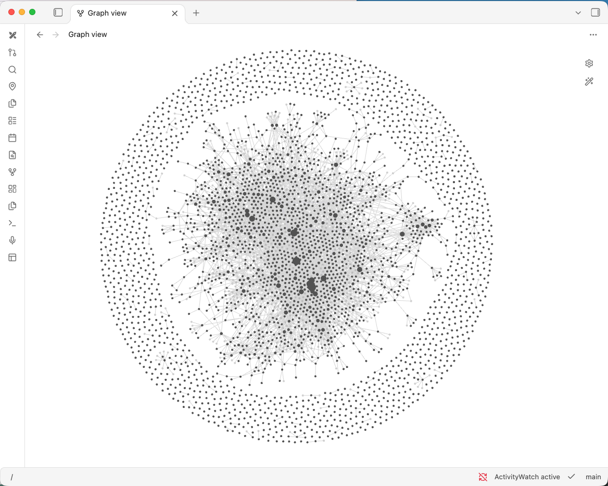
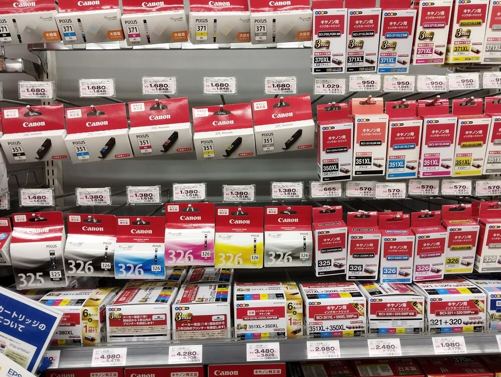

<style>
/* Deck-local styles for Obsidian Advanced Slides (reveal.js). */
.reveal { font-family: -apple-system, BlinkMacSystemFont, "Segoe UI", sans-serif; font-size: 30px; color: #243447; }
.reveal .slides { text-align: left; }
.reveal .slides section { box-sizing: border-box; padding: 24px 34px; }
.reveal h1, .reveal h2 { color: #153d56; text-transform: none; letter-spacing: -0.025em; line-height: 1.15; }
.reveal h1 { font-size: 1.65em; margin: 0 0 0.7em; padding-bottom: 0.3em; border-bottom: 4px solid #16857b; }
.reveal h2 { font-size: 1.2em; margin: 0.7em 0 0.4em; }
.reveal p, .reveal li { line-height: 1.4; }
.reveal p { margin: 0 0 0.7em; }
.reveal ul, .reveal ol { display: block; margin: 0 0 0.7em 1.15em; }
.reveal li { margin-bottom: 0.38em; padding-left: 0.12em; }
.reveal li > p { margin: 0; }
.reveal strong { color: #11695f; }
.reveal a { color: #116f9b; text-decoration: underline; text-underline-offset: 0.14em; }
.reveal table { width: 100%; margin: 0.5em 0; font-size: 0.78em; line-height: 1.4; border-collapse: collapse; }
.reveal table th { background: #153d56; color: white; }
.reveal table th, .reveal table td { padding: 0.55em 0.65em; border-bottom: 1px solid #cbd8de; vertical-align: top; }
.reveal table tbody tr:nth-child(even) { background: #eff5f6; }
.reveal code { font-size: 0.87em; background: #eef3f5; padding: 0.08em 0.2em; border-radius: 4px; }
.reveal pre { width: 100%; margin: 0.6em 0; box-shadow: none; font-size: 0.65em; }
.reveal pre code { padding: 18px 22px; line-height: 1.4; max-height: 460px; }
.reveal pre code, .reveal pre code * { color: #172b3a !important; background: #eef3f5 !important; opacity: 1 !important; }
.reveal section img { display: block; max-width: 100%; max-height: 510px; object-fit: contain; margin: 0.4em auto; border: 0; box-shadow: none; }
.reveal section.title-slide { padding-top: 150px; }
.reveal section.title-slide h1 { font-size: 2.15em; }
.reveal section.title-slide p:first-of-type { font-size: 1.2em; color: #11695f; }
.reveal section.activity h1 { border-color: #c17b25; }
.reveal section.activity > p:first-of-type { padding: 0.4em 0.65em; background: #fff3df; border-left: 5px solid #c17b25; font-size: 0.8em; }
.reveal section.activity > p:first-of-type strong { color: #805115; }
.reveal section.compact { font-size: 0.9em; }
.reveal .slide-number { font-size: 16px; background: #153d56; color: white; }
</style>

<!-- .slide: class="title-slide" -->

# Managing your digital world

From unstructured to structured data

Laurie Griffiths

<!-- Presenter: 0–0.5 min. Beginner workshop with short activities throughout. Timings include activities; optional extensions are outside the hour. Use pre-opened demo vaults. Participants may work with a partner or follow along. Keep plugin installation out of exercise time. -->

---

# What I want to know

- Whose birthday is coming up, and where should I send a card?
- Where did I meet this person?
- What was I doing on this project?
- Which water filter do I need?

<!-- Presenter: 0.5–1.5 min. Ask for a show of hands: who has looked for something they know they wrote down? -->

---

# What is Obsidian?

- An app for writing and connecting notes.
- A vault is a folder containing your notes. The notes are Markdown text files.
- Files hold the information. Links connect files.

<!-- Presenter: 1.5–2.25 min. Explain Markdown as plain text with a little formatting. Show a real file later. -->

---

# Get Obsidian

[https://obsidian.md](https://obsidian.md/)

Open the site to download Obsidian for your device.

<!-- Presenter: 2.25–2.5 min. Show the link. Participants without Obsidian can follow along or work with a neighbour. Avoid using workshop time for installation troubleshooting. -->

---

# Obsidian alternatives

Notion, Logseq, org-mode, and many other tools can help you organise information.

These ideas apply beyond Obsidian. This is the tool I happen to use.

<!-- Presenter: 2.5–3 min. Avoid a feature comparison or software ranking. -->

---

# My story

- I used to organise my digital life in Notion.
- I struggled to define tables before I knew what I needed.
- I switched to Obsidian in March 2025.
- I now have about 5,000 notes.

<!-- Presenter: 3–5 min. Personal experience, not a claim that Notion requires tables. Explain one daily-life benefit. -->

---

# My vault today



<!-- Replace the placeholder above with your screenshot, for example:  -->

<!-- Presenter: 5–5.5 min. Insert your own graph screenshot here. Briefly point out a recognisable cluster. The graph grew through use; this is not a structure beginners need to create on day one. -->

---

# How much structure?

| Less structured              | Some structure                              | More structured                                       |
| ---------------------------- | ------------------------------------------- | ----------------------------------------------------- |
| Free text and loose files    | Notes with links and properties             | Consistent tables and database schemas                |

<!-- Presenter: 5.5–7.5 min. This is a conceptual continuum, not a ranking of products. Obsidian can accommodate several levels in one vault. -->

---

# How much structure?

| Less structured              | Some structure                              | More structured                                       |
| ---------------------------- | ------------------------------------------- | ----------------------------------------------------- |
| A note about meeting someone | A person note linked to dated conversations | A contact table with birthdays and addresses          |

---

# How much structure?

| Less structured              | Some structure                              | More structured                                       |
| ---------------------------- | ------------------------------------------- | ----------------------------------------------------- |
| Scattered ideas for a game   | References linked to a design note          | A playtest spreadsheet with the same fields each time |

<!-- Presenter: 5.5–7.5 min. This is a conceptual continuum, not a ranking of products. Obsidian can accommodate several levels in one vault. -->

---

# Which ink cartridge?



<!-- Presenter: 7.5–8.5 min. I was at the home center. I knew I needed to buy a water filter.  But what type? What size?  Of course, normally the solution is to make a phone call.  'Hi, can you check the water filter? What type is it? What size?  Do we need a long life version?  No, no, you unscrew it.  It's not a backwards screw -->

---

# One useful note

## Water filter

Replacement cartridge: DEMO-WF-204

Check the label on the old cartridge before buying.

That is already useful.

<!-- Presenter: 8.5–9.5 min. Demo: Everyday vault, Household/Water filter. Search for water filter. Product number is fictional. -->

---

<!-- .slide: class="activity" -->

# Your turn

**3 minutes · Your own vault · No plugins**

1. Think of something you have had to look up more than once.
2. Create a note with a recognisable name.
3. Write the information you would need, or the question you still need to answer.
4. Navigate away, then find it again using search.

A product number, a useful command, a recipe adjustment, or instructions for an appliance.

<!-- Presenter: 9.5–12.5 min. Success is finding their own note again. Do not ask for properties or a folder system. Paper or a partner is fine. -->

---

# Helpful habits

- Write down information you expect to need again.
- Give things recognisable names.
- Give a person or project its own note when useful.
- Keep folders shallow.

A messy daily note is a fine starting point.  Start with chaos.

<!-- Presenter: 12.5–13 min. One thing per file is a starting habit, not a law. No need to split every sentence. -->

---

# Start Daily

Met [[Maya Chen]] at [[Autumn makers evening]].

We talked about a booking page for her repair café.

I said I would send a rough example on Friday.

<!-- Presenter: 13–14 min. Open Daily/2026-10-26. Point out: plain text, no frontmatter. Explain double brackets. In the slides these are illustrative links; follow them in the demo vault. -->

---

# Why daily notes work

- They follow what you actually do throughout the day.
- A day has a natural limit: you can only do so much.
- You can capture information while it is fresh.
- Dates preserve the context of conversations and decisions.
- You can start writing before deciding how to organise everything.

<!-- Presenter: 14–15 min. Daily notes do not need a template or frontmatter. They let relevant topics emerge from daily life instead of asking you to catalogue everything at once. -->

---

# A quick Markdown primer

| Purpose | Type this |
| --- | --- |
| Heading | `# Heading` |
| Smaller heading | `## Smaller heading` |
| List item | `- Something to remember` |
| Task | `- [ ] Send the sketch` |
| Website | `[link](example.com)` |
| Link to a note | `[[Maya Chen]]` |

<!-- Presenter: 15–16.5 min. Type a heading and both kinds of link. Double-bracket links are Obsidian-style wiki links, not standard Markdown syntax. The image example is a relative path to a real file. Blank lines separate paragraphs. Participants can refer back to this slide during the exercise. -->

---

# Where did we meet before?

A person note collects what you know about someone.

Backlinks show the notes that mention them.

The dated notes keep the context of each conversation.

<!-- Presenter: 16.5–19 min. Follow Maya, show backlinks, then open September 18. That conversation concerned a phone sign-up form. -->

---

# The note can grow when I need it

Maya runs a repair café.

Later, I might add a birthday, an address, or a follow-up task.

I do not need all of those fields on the day I meet her.

<!-- Presenter: 19–19.5 min. Show raw-to-structured example in demo-stages.md. Keep the daily note unchanged. -->

---

<!-- .slide: class="activity" -->

# Your turn: four minutes

1. Write two sentences about today.
2. Put double brackets around a person, project, or topic.
3. Open that link and add one useful sentence.
4. Find your way back to the original note.

Working on paper or watching is fine too.

<!-- Presenter: 19.5–23.5 min. Use participant-guide.md. No plugin installation. At two minutes, show a finished example. -->

---

# Properties: the start of structure

At the **very top** of a file:

````markdown
- - -
location: "33.59318873439, 130.401919735"
work_time: 2.5
date_completed: 2026-10-21
- - -

# Repair cafe website

Next time: ask whether bookings are for items or time slots.
````

- Start and end with `---` on their own lines.

<!-- Presenter: 23.5–26.5 min. These are YAML properties inside a Markdown file, not ordinary body text. The opening delimiter must be the first line. Show Source mode so the exact delimiters are visible; the property editor is another way to edit them. Here work_time is manually entered cumulative hours. A line such as summary: "Next: ask Maya" needs quotes around the value because it contains a colon followed by a space. Do not put the enclosing code fence into the actual project note. -->

---

# Dataview: a view of your notes

Dataview is a community plugin to build lists and tables.

**Settings → Community plugins → Browse → Dataview → Install → Enable**

[Dataview documentation](https://blacksmithgu.github.io/obsidian-dataview/)

The information stays in the source notes. The table is another way to see it.

<!-- Presenter: 26.5–27.5 min. If community plugins are disabled, enable them first. Demonstrate using the preconfigured Everyday vault. Anyone without Dataview can do the next activity's writing steps and watch the table demonstration. Do not turn on JavaScript queries; this workshop uses ordinary Dataview queries. -->

---

# A Dataview code block

Type this into a note, including the backticks:

````markdown
```dataview
TABLE summary AS "Summary", work_time AS "Hours"
FROM "Projects"
SORT file.name ASC
```
````

- Open with three backticks plus `dataview`; close with three backticks.
- `TABLE` chooses columns. `FROM` chooses a folder.
- Switch to Reading view to see the table.

<!-- Presenter: 27.5–29.5 min. Open Projects overview. The Projects folder name and property names must match exactly. Demonstrate a source edit updating the result. The surrounding four-backtick fence is only for displaying the example on this slide; participants type the inner three-backtick block. -->

---

# Don't panic!

AI is very good at writing dataview queries!

---

<!-- .slide: class="activity" -->

# Your turn

**4 minutes · Everyday vault or your own vault**

1. Create a note in `Projects` for a real or fictional project.
2. Write what happened last time and one concrete next action.
3. Add `summary` and a numeric `work_time` in frontmatter.
4. Open `Projects overview`, change your summary, and check the table again.

**No Dataview?** Complete the note, then compare its properties with a neighbour's.

<!-- Presenter: 29.5–33.5 min. Help participants get one valid example working. Hours are entered manually, not calculated from the prose. Ask: what is easy to see in a table, and what still needs the full note? Success is a note that helps them resume work. -->

---

# Who has a birthday next month?

- A date and address in each person note let me make a useful list.
- Incomplete data is still useful. 
- I want to solve the problems I have right now

<!-- Presenter: 33.5–34.5 min. Open Birthdays. Demo clock is October 26, 2026, and next month means November. Show Maya and Alex. Query is in the handout vault, not on this slide. -->

---

# A small CRM

A note remembers the conversation.

A table compares contacts.

A board shows what to do next.

Contact to make / Waiting for reply / Next step agreed

<!-- Presenter: 34.5–36 min. Open Contacts overview, then Contact board. Move the Cedar Studio card. Board columns are manually maintained, not automatically synced to person properties. -->

---

<!-- .slide: class="activity compact" -->

# Your turn: remember the conversation, move the work

**3 minutes · Everyday demo vault**

1. Find where Maya met you previously and what you discussed. Try backlinks.
2. Imagine you have sent Cedar Studio a request for portfolio examples.
3. Move its card from **Contact to make** to **Waiting for reply**.
4. Open the linked Cedar Studio note and record what you asked for.

**No Kanban?** Move the list item under the relevant Markdown heading.

<!-- Presenter: 36–39 min. Spend the first minute finding Maya's September 18 conversation at Community repair afternoon about a phone-friendly sign-up form. Then allow two minutes for the board and note. No message is actually sent. Moving a card does not automatically update properties in the linked note. -->

---

# Study and creative work

A game mechanic. A passage in a book. A question from a paper.

Each can become a note, with a source and a thought of my own.

<!-- Presenter: 39–40 min. Switch to Game design vault. Open Daily/2026-10-24, then Bells and boats. Sources in this example are explicitly fictional. -->

---

# Connections become a design

What if players had to coordinate a rescue with limited communication?

Combine references into a design note.

Try it, record what happened, and revise the design.

<!-- Presenter: 40–41 min. Follow Limited communication to Harbour rescue v1, then Playtest 01 and v2. Use local graph if time. The valuable part is the reason for a change, not graph density. -->

---

<!-- .slide: class="activity" -->

# Your turn: combine two references

**4 minutes · Game design demo vault**

1. Choose two notes from `References`.
2. Create a game idea and link to both sources.
3. Describe what players do and one question you would test.

**After three minutes:** a playtest suggests one player has very little to do.

Add a possible change and explain why it might help.

<!-- Presenter: 41–46 min. Give the playtest prompt aloud at three minutes. Keep the first idea visible so the reason for the revision survives. The references are fictional. A short paragraph and two links are enough. -->

---

# A business example

First, a conversation in a daily note.

Then, a note for each owner and potential site.

Add location and status when comparing sites becomes useful.

<!-- Presenter: 46–47 min. Solar vault: Daily/2026-10-26, Aki Mori, then North field. Map coordinates are illustrative, not genuine leads. -->

---

# Two views of the same sites

A map shows where they are.

A graph shows which notes connect.

One owner can connect to several site notes.

<!-- Presenter: 47–48 min. Map View: three markers. Local graph of Aki Mori: North field and Orchard edge. Graph edges mean links; the notes explain that the relationship is ownership. -->

---

<!-- .slide: class="activity" -->

# Your turn: one owner, another site

**3 minutes · Solar demo vault**

1. Create a new note in `Sites` with an invented name.
2. Link it to `[[Aki Mori]]`.
3. Write its status and one unanswered question.
4. Find the new connection in Aki's backlinks or local graph.

**Optional extension:** add `owner`, `status`, and `location` properties, then find the site in the table and map.

<!-- Presenter: 48–52 min. The core activity needs no community plugins. Keep the owner link in the note body for an easy graph demonstration. For the extension, quote the owner value as "[[Aki Mori]]" and copy a sample location format from an existing site. Locations are illustrative, not real leads. Do not spend the main exercise time configuring the map. -->

---

# What I would do in my first week

Choose one question you often need to answer.

Write a little each day. Add links when something comes up again.

When finding or comparing information becomes awkward, try adding structure.

<!-- Presenter: 52–53 min. There is no requirement to adopt every demo. Start with a folder, a daily note, and search. -->

---

# What you can do now

- Create a note.
- Link it to another note.
- Find the information again.
- Recognise when a property or a different view might help.

Your own workflow will develop with use.

<!-- Presenter: 53–54 min. Mention the guide and demo vaults. Sync to another device is a separate setup step; a local vault is not automatically on a phone. -->

---

<!-- .slide: class="activity" -->

# Your first step

**1 minute · Write this in your own vault**

This week, I'll use Obsidian to help me ______.

The next thing I'll record is ______.

Choose something small enough to try today.

<!-- Presenter: 54–55 min. Give people a quiet minute to write. They do not need to adopt every workflow or plugin from the talk. -->

---

# Questions

- What information do you have in your life that you want to organize?

<!-- Presenter: 55–60 min. If short of time, invite one question about starting rather than individual plugin troubleshooting. -->
